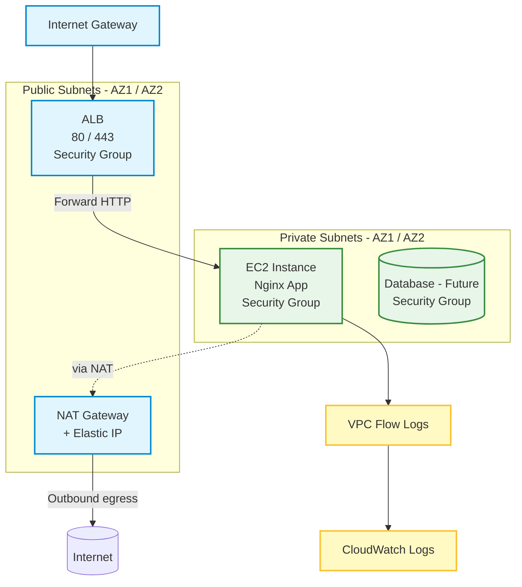

# 🏗️ Secure VPC Architecture with Terraform

[](https://github.com/Mihirajmera/secure-vpc-architecture/actions/workflows/terraform-ci.yml)
[](https://github.com/Mihirajmera/secure-vpc-architecture/actions/workflows/codeql.yml)
[](https://scorecard.dev/viewer/?uri=github.com/Mihirajmera/secure-vpc-architecture)
[](https://github.com/Mihirajmera/secure-vpc-architecture/releases)

Enterprise-grade secure VPC architecture implementing Zero Trust networking principles with automated infrastructure deployment

## 🎯 Project Overview

This project demonstrates advanced AWS networking and security best practices by building a production-ready VPC architecture that follows the Zero Trust security model. The infrastructure ensures that all traffic is encrypted, logged, and follows the principle of least privilege access.

## Compliance evidence (policy as code)

Every change is scanned with [Checkov](https://www.checkov.io/) in CI, and each result is mapped to **NIST SP 800-53 Rev. 5** and the **CIS AWS Foundations Benchmark v3.0.0** ([`compliance/iac_controls.yaml`](compliance/iac_controls.yaml)). A finding can't just be ignored: it has to be **fixed**, or recorded in [`compliance/exceptions.yaml`](compliance/exceptions.yaml) as *risk-accepted*, *not-applicable* or *deferred*, with a reason and an expiry date. CI fails on any finding without a valid exception, including expired ones.

**→ [Read the evidence report](compliance/report.md)** · [OSCAL assessment results](compliance/assessment-results.json)

```bash
pip install --require-hashes -r compliance/requirements.txt
checkov -d . --framework terraform -o json --compact --skip-download --skip-path compliance > compliance/checkov.json
python compliance/iac_evidence.py compliance/checkov.json
```

## 🏆 Key Achievements

- ✅ Zero Trust Architecture - No direct internet access to private resources
- ✅ High Availability - Multi-AZ deployment with redundancy
- ✅ Security Hardening - Least privilege security groups and VPC Flow Logs
- ✅ Cost Optimization - Right-sized resources with clear cost estimates
- ✅ Infrastructure as Code - Fully automated deployment with Terraform

## 🏗️ Architecture Diagram



## 🚀 Features & Technologies

### 🔒 Security Features
- Private Subnet Isolation - EC2 instances have no direct internet access
- Least Privilege Security Groups - Only necessary ports are open
- VPC Flow Logs - Complete network traffic monitoring
- NAT Gateway - Secure outbound internet access for private resources
- Application Load Balancer - SSL termination and health checks

### 🛠️ Infrastructure Components
- VPC - Custom network with public/private subnets across 2 AZs
- Internet Gateway - Internet access for public resources
- NAT Gateway - Outbound internet access for private resources
- Application Load Balancer - High availability and SSL termination
- EC2 Instance - Private web server with Nginx
- Security Groups - Network-level firewall rules
- VPC Flow Logs - Network traffic logging to CloudWatch

### 📊 Monitoring & Observability
- CloudWatch Logs - Centralized logging for VPC Flow Logs
- Health Checks - ALB health monitoring
- Terraform State - Infrastructure state management

## 🔒 Security Group Rules

| Security Group | Rule | Purpose |
|---|---|---|
| ALB SG | Allow 80/443 inbound from internet | Public ingress |
| App SG | Allow 80 inbound from ALB SG only | No direct internet exposure |
| DB SG | Allow 5432 inbound from App SG only | Placeholder for future RDS use |

## 🏃‍♂️ Quick Start

### Prerequisites
- Terraform >= 1.7
- AWS CLI configured
- AWS Account with appropriate permissions

### 🚀 Deployment

**Clone and Navigate**
```bash
git clone https://github.com/Mihirajmera/secure-vpc-architecture.git
cd secure-vpc-architecture
cp terraform.tfvars.example terraform.tfvars   # then edit values; terraform.tfvars is git-ignored
```

**Configure AWS Credentials**
```bash
# Preferred: short-lived credentials through AWS IAM Identity Center (SSO)
aws configure sso --profile vpc-lab
export AWS_PROFILE=vpc-lab

# Never put access keys in .tf or .tfvars files. See credentials-setup.md.
```

**Deploy Infrastructure**
```bash
# Initialize Terraform
terraform init

# Plan deployment (tfplan is git-ignored: plan files can contain sensitive values)
terraform plan -out tfplan

# Apply changes
terraform apply -auto-approve tfplan
```

**Test Application**
```bash
# Get ALB DNS name
terraform output alb_dns_name

# Open URL in browser (wait 2-3 minutes for EC2 startup)
# Expected: "secure-vpc-architecture - Nginx up"
```

### 🧹 Cleanup
```bash
terraform destroy -auto-approve
```

## 🤖 CI/CD Pipeline

This repository includes a GitHub Actions workflow (`.github/workflows/terraform-ci.yml`) that automatically runs on pushes and pull requests to `master` or `main`.

The pipeline performs:
- **Terraform Linting**: Checks formatting consistency using `terraform fmt -check`.
- **Terraform Validation**: Validates the Terraform configuration syntax and schema.
- **Security Auditing**: Integrates Aqua Security's **Trivy** scan to detect high/critical severity security risks and misconfigurations.

## 💰 Cost Analysis

| Resource | Monthly Cost | Purpose |
|---|---|---|
| NAT Gateway | ~$45 | Private subnet internet access |
| Application Load Balancer | ~$16 | High availability & SSL |
| EC2 t3.micro | ~$8 | Web server |
| Data Transfer | ~$1-5 | Network traffic |
| **Total** | **~$70-75** | Complete secure architecture |

💡 **Cost Optimization**: Use `terraform destroy` when not testing to avoid charges

## 🔧 Configuration

### Variables (terraform.tfvars, copied from terraform.tfvars.example)
```hcl
aws_region   = "us-east-1"
project_name = "secure-vpc-architecture"
environment  = "dev"

# Network Configuration
vpc_cidr              = "10.0.0.0/16"
public_subnet_cidrs   = ["10.0.1.0/24", "10.0.2.0/24"]
private_subnet_cidrs  = ["10.0.101.0/24", "10.0.102.0/24"]
```

### Inputs

| Variable | Default |
|---|---|
| `project_name` | `secure-vpc-architecture` |
| `aws_region` | `us-east-1` |
| `vpc_cidr` | `10.0.0.0/16` |
| `public_subnet_cidrs` | `[10.0.1.0/24, 10.0.2.0/24]` |
| `private_subnet_cidrs` | `[10.0.101.0/24, 10.0.102.0/24]` |
| `tags` | map |

## 📁 Project Structure

```
secure-vpc-terraform/
├── versions.tf              # Terraform and provider versions
├── providers.tf             # AWS provider configuration
├── variables.tf             # Input variables
├── networking.tf            # VPC, subnets, IGW, public routing
├── nat.tf                   # EIP, NAT Gateway, private routing
├── security_groups.tf       # ALB, App, DB security groups
├── ec2.tf                   # Private EC2 instance and Nginx user data
├── alb.tf                   # ALB, Target Group, Listener, Attachment
├── flow_logs.tf             # CloudWatch Logs, IAM role/policy, VPC Flow Logs
├── outputs.tf                # Terraform outputs (e.g. ALB DNS)
├── terraform.tfvars.example  # Example configuration values (copy to terraform.tfvars)
└── README.md                 # This file
```

## 📝 Notes
- EC2 instance resides in a private subnet without a public IP; the ALB provides ingress.
- EC2 uses an SSM role for session management (no SSH needed). If you want SSH, add a key pair and ingress accordingly (not recommended for production).
- The NAT Gateway incurs cost — run `terraform destroy -auto-approve` when done testing.

## 🎓 Learning Outcomes

This project demonstrates mastery of:

### 🏗️ Infrastructure as Code
- Terraform - Declarative infrastructure management
- State Management - Infrastructure state tracking
- Modular Design - Reusable and maintainable code

### ☁️ AWS Services
- VPC - Virtual Private Cloud networking
- EC2 - Elastic Compute Cloud instances
- ALB - Application Load Balancer
- NAT Gateway - Network Address Translation
- Security Groups - Network-level security
- CloudWatch - Monitoring and logging

### 🔒 Security Best Practices
- Zero Trust Architecture - No implicit trust
- Least Privilege Access - Minimal necessary permissions
- Network Segmentation - Public/private subnet isolation
- Traffic Monitoring - VPC Flow Logs implementation

### 📊 DevOps Practices
- Infrastructure Automation - Repeatable deployments
- Version Control - Git-based workflow
- Documentation - Comprehensive project documentation
- Cost Management - Resource optimization

## 🚀 Future Enhancements
- SSL/TLS Termination - HTTPS with ACM certificates
- Auto Scaling - EC2 Auto Scaling Groups
- Database Integration - RDS PostgreSQL in private subnets
- CI/CD Deployment - Automated infrastructure deployment upon pull request merge
- Monitoring - CloudWatch dashboards and alarms
- Backup Strategy - Automated snapshots and backups

## 🤝 Contributing
1. Fork the repository
2. Create a feature branch (`git checkout -b feature/amazing-feature`)
3. Commit your changes (`git commit -m 'Add amazing feature'`)
4. Push to the branch (`git push origin feature/amazing-feature`)
5. Open a Pull Request

## 📄 License
This project is licensed under the MIT License - see the LICENSE file for details.

## 👨‍💻 Author
**Mihir Ajmera** — GRC Engineer & Cloud Security

- LinkedIn: [Mihir Ajmera](https://linkedin.com/in/mihirajmera)
- GitHub: [Mihirajmera](https://github.com/Mihirajmera)
- Email: ajmera.mihir.79@gmail.com

⭐ Star this repository if you found it helpful!

*This project showcases enterprise-level AWS infrastructure design and implementation — demonstrating cloud architecture expertise for technical interviews.*
